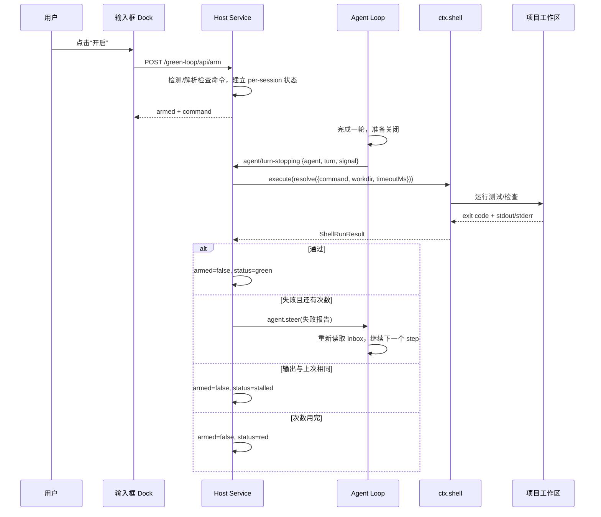
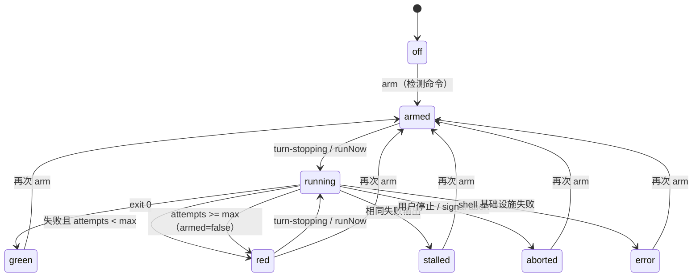

# 架构与机制说明

本文解释 Green Loop 为什么这样拆，以及“自动修到绿”在 DSH 里到底依赖哪些机制。

## 1. 目标与非目标

**目标**：让“完成”由一个可执行的项目检查决定，而不是由模型自述决定。

**非目标**：

- 不做需求拷问、spec 评审、代码风格判断——那是 `dsh-doublecheck` 一类工具的职责。
- 不自动开启。自动执行命令是用户授权，不是模型权限。
- 不做跨重启的持久队列。循环是当前进程里的主动行为，重启后重新开启。

## 2. 一次循环的时序

关键点：`agent/turn-stopping` 是**回合关闭前**的串行事件；监听器里调用 `agent.steer(...)` 会让循环重新读取
inbox，有新的 next-step 就继续跑，没有才真正关闭。这就是“同一回合里修到绿”的支点，而不是另起一个回合。

## 3. 状态机

状态字段：

| 字段 | 含义 |
|---|---|
| `armed` | 下一轮结束时是否自动检查 |
| `running` | 当前是否有一个检查在跑 |
| `attempts` / `maxAttempts` | 当前开启周期已检查次数 / 上限 |
| `status` | `off`、`armed`、`running`、`green`、`red`、`stalled`、`error`、`aborted` |
| `command` / `commandSource` | 解析出的命令与来源（config / 检测） |
| `cwd` | 检查运行目录 |
| `last` / `history` | 最近一次结果 / 最近 10 次摘要 |

## 4. 命令解析

`config.command` 非空时直接用。否则 `detect.js` 只读项目根目录的元数据：

1. `package.json` 有 `scripts.test`：按 lockfile 选 `pnpm` / `yarn` / `bun run` / `npm`。
2. Python 布局：`pytest -q`，有 `uv.lock` / `poetry.lock` 时加 `uv run` / `poetry run`。
3. `go.mod` → `go test ./...`；`Cargo.toml` → `cargo test`。
4. `Makefile` 有 `test:` 目标 → `make test`。

检测是启发式的，且只在根目录；monorepo 用 `config.command` 覆盖。检测结果会显示在 Dock 里，用户看到命令后才可能开启。

## 5. 执行边界与安全

- 检查走 `ctx.shell`，与 `bash` 工具共享执行器、沙箱、工作目录和环境。
- `timeoutMs` 到点由执行器杀掉命令；`signal` 取消也会杀掉。
- 失败输出只保留 `outputTailChars`，用于 steer 和 Dock；完整输出不进入本插件存储。
- 插件不读凭据、不发网络请求、不修改项目文件；唯一副作用是运行用户配置/检测出的检查命令。
- **开启即授权**：开启后每轮结束都会自动执行该命令。README 里明确提示只在可信项目使用。

## 6. 为什么用 `agent.steer` 而不是 `followup`

- `followup` 会排队一个**新的回合**，用户会看到“完成”之后又冒出一条新消息，体验割裂。
- `steer` 把内容投递到最近的 step 边界；在 `turn-stopping` 里调用会阻止回合关闭，Agent 在同一回合里继续修。
- 这要求检查在 `turn-stopping` 内完成；因此单次检查必须有超时，否则会让回合长时间停住。

## 7. 为什么不用 `turn/end`

`turn/end` 只是记录回合已经结束；它不能重开回合。`turn-stopping` 是“关闭前”的唯一挂点，并且明确支持通过
steer 让回合保持打开。两者语义不同，选择由“是否需要 Agent 继续工作”决定。

## 8. 失败模式

| 情况 | 行为 |
|---|---|
| 命令不存在 / 检测不到 | `arm`/`run` 返回 400 `no-check`，Dock 显示错误；不会开启 |
| 命令非零退出 | 计一次失败；未超次数则 steer，否则 `red` |
| 命令超时 | `timedOut`，计一次失败；输出尾部保留 |
| 连续两次相同输出 | `stalled`，不再 steer，避免无效循环 |
| shell 启动失败 | `error`，不 steer；Dock 显示错误 |
| 用户停止 | abort 正在跑的检查，`aborted`，不再 steer |
| Agent 在检查期间被释放 | `agent.steer` 抛错被捕获，状态转 `error` |
| 两个调用方同时跑 | 引擎的 per-session `#active` 拒绝第二个，返回 `busy` |

## 9. 调用方与接口

| 调用方 | 入口 | 说明 |
|---|---|---|
| 用户（Dock） | `GET /green-loop/api/state`、`POST arm/disarm/run` | Connection 认证；同一套 service |
| 用户（命令） | `/green start\|stop\|run\|status` | 命令结果进入会话日志，不进入模型历史 |
| 模型 | `green_check` / `green_status` | 只探测/读状态；没有开启权限 |
| 其他插件 | `ctx.greenLoop.status(sessionId)` | 只读状态 |

## 10. 可扩展方向

- 每条命令独立配置（test / lint / typecheck），按顺序运行，第一个失败即停。
- 按 workspace 保存“上次开启的检查”，重启后恢复。
- 失败输出做去噪（去掉时间戳、耗时）后再比较，减少 `stalled` 误判。
- 与 `dsh-doublecheck` 组合：Green Loop 负责“跑绿”，doublecheck 负责“交付证据”。
- 在 Dock 里增加“只跑一次 / 连续跑”模式切换。
